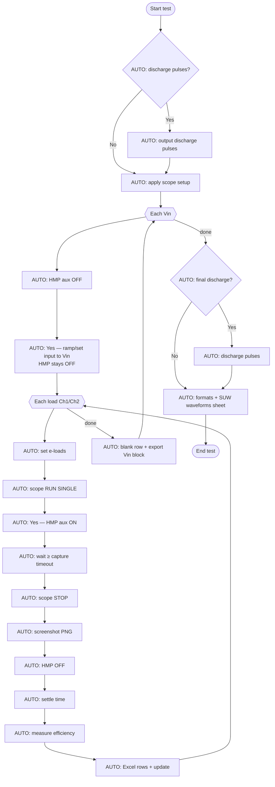
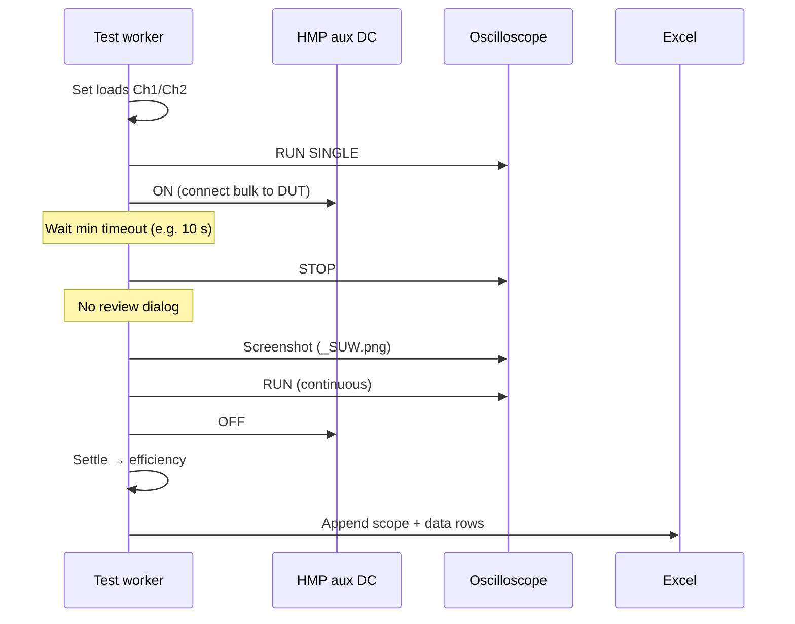

# Startup Waveform 2 Port — fully automated flow

**Setting:** User Prompts = **None (Fully Automated)** (gear / I²C combo index 2 on waveform tests)

This doc shows **two layers**:

1. **What the Add Test sequence (➜) text shows** — only Pre-Test and Per-Capture steps are marked skipped.
2. **What actually runs unattended** — same as verify/simulation scripts: set **`PI_ATE_AUTO_CONFIRM=1`** so OK/Yes dialogs auto-accept (see below).

Sources: `page_controls/test_sequence_flow_text.py`, `test_startup_2port_waveform.py`, `test_efficiency_2port_waveform.py` (`prompt_before_start`, `prompt_before_capture`, `create_message_popup`).

---

## Effective automated flow (recommended for unattended runs)

Use **User Prompts: None (Fully Automated)** **and** `PI_ATE_AUTO_CONFIRM=1` (or `--auto-confirm` on hardware smoke script).



**Skipped vs default (Per-Capture Only):**

| Step | Fully automated + `PI_ATE_AUTO_CONFIRM=1` |
|------|------------------------------------------|
| OK — discharge bulk cap | **Skipped** (`create_message_popup` returns immediately) |
| OK — oscilloscope setup reminder | **Skipped** (no Pre-Test in User Prompts) |
| Yes/No — charge bulk to Vin | **Auto Yes** (`_ask_yes_no`) |
| Yes/No — start capture | **Auto Yes** |
| Review Proceed / Recapture / Skip / Stop | **Skipped** (no Per-Capture in User Prompts) |
| Recapture loop | **Not used** (no review → never `RECAPTURE`) |

Default **capture timeout** remains **10 s** unless changed in advanced parameters.

---

## GUI-only: None (Fully Automated) without `PI_ATE_AUTO_CONFIRM`

If you only change the combo to **None (Fully Automated)** and do **not** set the env var, the test is **not** fully hands-off:

| Step | Still appears? |
|------|----------------|
| OK — discharge bulk cap | **Yes** (warning dialog) |
| Yes/No — charge bulk | **Yes** |
| Yes/No — start capture | **Yes** |
| Scope pre-test OK | No |
| Per-capture review | No |

So “fully automated” in the UI today means **no scope OK / no capture review**, not **no bench Yes/No**. Headless verification always sets `PI_ATE_AUTO_CONFIRM=1` (see `scripts/verify_startup_2port_waveform.py`).

---

## Canonical Add Test sequence text (Fully Automated)

```
STARTUP WAVEFORM 2 PORT — SEQUENCE
Dual Load Mode: Option A
User Prompts: None (Fully Automated)
Capture Timeout: 10 s (gear → advanced)

=== ONCE AT TEST START ===
[AUTO] Output discharge pulses (×2)
  →
[USER] OK — Discharge DUT outputs to input bulk cap
  →
(skipped — not in User Prompts) [USER] OK — Oscilloscope setup reminder
  →
[AUTO] Apply scope setup

=== EACH Vin STEP (before load points) ===
[AUTO] HMP aux DC OFF (bulk cap disconnected from DUT)
  →
[USER] Yes/No — Start charging bulk cap to this Vin?
  → [AUTO] If Yes: HMP OFF + ramp / set input voltage
  → [AUTO] If No: skip all load points at this Vin

=== EACH LOAD POINT AT THIS Vin — REPEAT ===
[AUTO] Set e-loads (Ch1 / Ch2)
  →
[AUTO] Scope RUN SINGLE
  →
[USER] Yes/No — Start startup waveform capture?
  → [AUTO] If Yes: HMP aux DC ON
  →
[AUTO] Wait minimum 10 s, then scope STOP
  →
(skipped — not in User Prompts) [USER] Review capture (Proceed / Recapture / Skip / Stop)
  →
[AUTO] Screenshot + scope row + efficiency + Excel + HMP OFF

=== RECAPTURE ===
HMP OFF → RUN SINGLE → Yes/No capture → HMP ON → wait → STOP → review
(In fully automated mode, review is skipped — recapture path inactive.)

=== END OF TEST ===
[AUTO] Final discharge pulses
  →
[AUTO] Save workbook + SUW waveforms sheet
```

---

## Per load point — automated path (detail)



---

## How to run fully automated locally

**Simulation / CI-style (no GUI prompts):**

```bat
set PI_ATE_AUTO_CONFIRM=1
python scripts\verify_startup_2port_waveform.py
```

**Hardware smoke (optional auto-confirm):**

```bat
python scripts\run_startup_2port_hardware_smoke.py --auto-confirm
```

Test plan should include User Prompts **None (Fully Automated)** in saved `cbx_params` (same as verify scripts).

---

## Related doc

Interactive (Per-Capture) flow: [Startup_Waveform_2Port_Test_Sequence.md](./Startup_Waveform_2Port_Test_Sequence.md)
