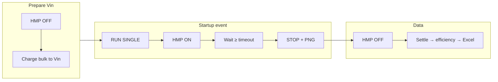

# Does the Startup Waveform 2 Port sequence make sense?

**Short answer:** **Yes, for the intended bench story** — charge/isolate the bulk cap, arm the scope, **connect with HMP** to create a controlled startup, capture, then log data. The flow matches a real bulk-cap startup workflow and the code matches the documented UI sequence.

There are a few **operator defaults** and **edge cases** worth knowing if you are changing features.

---

## What the sequence is trying to do (and why it fits)

| Phase | Intent |
|--------|--------|
| Discharge bulk once | Known empty cap before the first charge. |
| Per **Vin**: HMP OFF → Yes/No charge | Cap at target input while **DUT is not on the cap** (Magna/HVDC ramps bulk; HMP is the connect switch). |
| Per **load**: set loads → **RUN SINGLE** → Yes/No → **HMP ON** | Scope is armed **before** the connect event; startup happens on HMP ON, not on an accidental earlier energization. |
| Fixed **minimum wait** → **STOP** | Single-shot capture with a bounded window (default **10 s**); avoids hanging forever if trigger is imperfect. |
| Per-capture **review / recapture** | Human checks the right event was caught; recapture deliberately does **HMP OFF → re-arm**. |
| **Efficiency after** capture + settle | Same Excel row as steady-state 2-port tests: waveform row + efficiency columns for that load point. |

That ordering — **isolate → charge → arm scope → connect → record → (optional) steady metrics** — is coherent for startup/inrush characterization on a bench where HMP is **Aux DC**, not the main line supply.

---

## What already lines up well

1. **GUI-thread Yes/No** — Bulk charge and capture prompts cannot deadlock the test worker; matches recent commit focus (`dbf7486`).
2. **HMP resolution** — Aux DC or fallback among `dc_sources` when roles were incomplete; matches “HMP is not the primary Magna supply.”
3. **Auto Find Trigger off** for startup — Startup is event-based on connect; fixed trigger channel + `.DFL` is the right default.
4. **Recapture path** — Turns HMP off before re-arming; avoids capturing the wrong half of a double connect.
5. **Skip whole Vin on “No charge”** — Avoids load sweeps at an input you did not prepare.
6. **Bulk ramp (DC + Magna)** — Reuses steady-state 2-port ramp logic so inrush into the cap is controlled, not a step to full Vin.

---

## Things to double-check on the bench (not necessarily bugs)

### 1. Efficiency is measured after **HMP OFF**

After a good capture, the code runs **`_hmp_off` → settle → `_measure_efficiency`**. If your wiring means **HMP OFF removes input power from the DUT**, efficiency numbers for that row may **not** be true steady-state loaded efficiency — they reflect whatever is left on the rails (or near zero).

**If** your intent is “efficiency at the load point after startup has finished,” you may want **HMP ON** (or line energization as you use in production) through the efficiency sample, then disconnect before the next point.

**If** your intent is “efficiency column is informational / same sheet layout as SSW” and operators accept post-event state, current order is fine.

### 2. Declined capture still runs efficiency

If the operator clicks **No** on “Start startup waveform capture?”, **HMP never turns on**, but the loop still **measures efficiency** and writes a full row (scope columns N/A). That can produce **misleading efficiency** unless the DUT is powered some other way.

Consider skipping `_measure_efficiency` when capture was declined, or marking the row invalid in Excel.

### 3. Multiple load points at the **same Vin** without re-charge

Charge Yes/No runs **once per Vin**, not per load. Later points at that Vin: **HMP OFF** from the previous point, same charged bulk, new **HMP ON** for each capture. That can be correct (repeat connect events) or wrong if you need a **fresh discharge/charge** per load for a true startup — product/test-plan dependent.

### 4. Default **Per-Capture Only** skips pre-test scope OK

The oscilloscope setup reminder (`.DFL`, probes, trigger CH) is **off** unless User Prompts includes **Pre-Test**. For a scope-heavy test, many teams prefer **Pre-Test & Per-Capture** on first bring-up.

### 5. **Fixed 10 s** wait vs trigger

You arm single-shot and stop after a **minimum time**, not necessarily on trigger position or a scope “acquisition complete” flag. Fast startups may sit in the tail of the window; slow ones may be clipped. Tuning **capture timeout** (advanced param) or adding trigger-aware stop would be a feature change, not a sequence logic error.

---

## Verdict

| Aspect | Assessment |
|--------|------------|
| Overall startup narrative | **Makes sense** for bulk-cap + HMP connect + scope single-shot. |
| Code vs UI flow text | **Aligned** (`test_startup_2port_waveform.py` ↔ `build_startup_flow_text()`). |
| Operator model | **Heavy on Yes/No** by design; good for bench safety, less for fully automated regression (`PI_ATE_AUTO_CONFIRM=1` bypasses dialogs only). |
| Likely improvement targets | Efficiency **with HMP/state** after capture; **skip efficiency** when capture declined; optional **re-discharge** between points or Vin blocks. |

---

## If you change features next

Tell me which direction you care about, for example:

- Leave HMP on through efficiency, then off before next RUN SINGLE  
- Skip efficiency when capture skipped  
- Re-prompt bulk discharge between load points  
- Restore pre-test scope reminder as default for Startup only  

Those are small, localized changes in `test_startup_2port_waveform.py` and/or defaults in `_build_tc_default()`.
