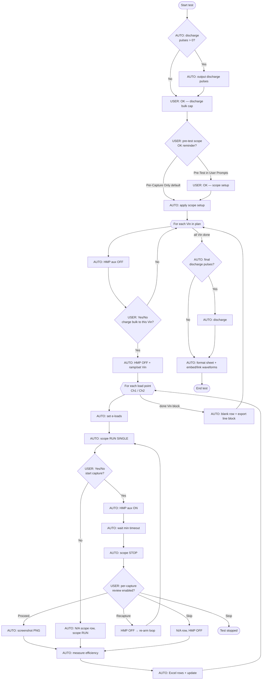
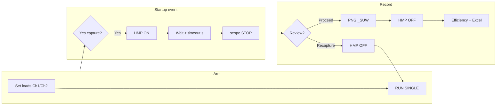

# Startup Waveform 2 Port — test sequence

**Test class:** `StartupWaveformTest_2Port` (`psu_tests/test_startup_2port_waveform.py`)  
**UI sequence copy:** `page_controls/test_sequence_flow_text.py` → `build_startup_flow_text()`  
**Defaults:** User Prompts = **Per-Capture Only**; capture timeout = **10 s**; Auto Find Trigger = **off**

Bench role: charge the **input bulk cap** through the line supply while **HMP aux DC is OFF** (DUT disconnected), then **HMP ON** to connect bulk cap to DUT for startup; scope **RUN SINGLE** → wait → **STOP** → PNG + Excel.

---

## High-level flow (Mermaid)



---

## Per load point — capture detail (Mermaid)



Default **timeout** is read from advanced parameter index 10 (11th I²C/GUI param), default **10.0 s** (`STARTUP_CAPTURE_TIMEOUT_DEFAULT_S`).

---

## Once at test start

| Step | Actor | Action |
|------|--------|--------|
| 1 | AUTO | Optional **output discharge pulses** (if `discharge_pulses > 0`) |
| 2 | USER | **OK** — discharge input **bulk capacitor** (warning dialog) |
| 3 | USER | **OK** — oscilloscope setup reminder *(only if User Prompts includes **Pre-Test**)* |
| 4 | AUTO | **Apply scope setup** (trigger channel fixed; no auto-find) |

With default **Per-Capture Only**, step 3 is skipped in the Add Test flow text as *(skipped — not in User Prompts)*.

---

## Each Vin step (before load points)

| Step | Actor | Action |
|------|--------|--------|
| 1 | AUTO | **HMP aux DC OFF** — bulk cap disconnected from DUT |
| 2 | USER | **Yes/No** — start charging bulk cap to this **Vin**? |
| 3a | AUTO | **Yes:** keep HMP OFF, **ramp or set** input supply to Vin (and AC freq if AC) |
| 3b | AUTO | **No:** skip **all load points** at this Vin |

---

## Each load point at this Vin (repeat)

| Step | Actor | Action |
|------|--------|--------|
| 1 | AUTO | Set electronic loads (**Ch1 / Ch2** per dual-load mode, e.g. Option A) |
| 2 | AUTO | Oscilloscope **RUN SINGLE** |
| 3 | USER | **Yes/No** — start startup waveform capture? |
| 4 | AUTO | **Yes:** **HMP aux DC ON** (bulk cap to DUT) |
| 5 | AUTO | Wait **minimum capture timeout** (default 10 s), then **scope STOP** |
| 6 | USER | **Review capture** — Proceed / Recapture / Skip / Stop *(Per-Capture Only default)* |
| 7 | AUTO | Screenshot (`*_SUW.png`), scope measurement row, **efficiency**, Excel update, **HMP OFF** |
| 8 | AUTO | Settle time + post-capture delay; continue to next load or next Vin |

If capture is declined at step 3, scope returns to **RUN** and scope row is **N/A**; efficiency step still runs.

---

## Recapture loop

When the operator chooses **Recapture** at review:

1. **HMP OFF**
2. **RUN SINGLE** again
3. **Yes/No** — start capture (same as normal)
4. **HMP ON** → wait → **STOP** → review again

Implemented in `capture_startup_at_point()` (`continue` on `RECAPTURE`).

---

## End of test

| Step | Actor | Action |
|------|--------|--------|
| 1 | AUTO | Optional **final discharge pulses** |
| 2 | AUTO | Main sheet number formats; link/embed waveforms on **SUW** sheet if configured |

Workbook naming uses prefix **`SUW`** / short title **`SU_WF_2P`**.

---

## Canonical UI sequence text (defaults)

Same string shown in the **Add Test → sequence (➜)** dialog when options match defaults:

```
STARTUP WAVEFORM 2 PORT — SEQUENCE
Dual Load Mode: Option A
User Prompts: Per-Capture Only
Capture Timeout: 10 s (gear → advanced)

=== ONCE AT TEST START ===
[AUTO] Output discharge pulses (×2)
  →
[USER] OK — Discharge DUT outputs to input bulk cap
  →
(skipped — not in User Prompts) [USER] OK — Oscilloscope setup reminder
  →
[AUTO] Apply scope setup

=== EACH Vin STEP (before load points) ===
[AUTO] HMP aux DC OFF (bulk cap disconnected from DUT)
  →
[USER] Yes/No — Start charging bulk cap to this Vin?
  → [AUTO] If Yes: HMP OFF + ramp / set input voltage
  → [AUTO] If No: skip all load points at this Vin

=== EACH LOAD POINT AT THIS Vin — REPEAT ===
[AUTO] Set e-loads (Ch1 / Ch2)
  →
[AUTO] Scope RUN SINGLE
  →
[USER] Yes/No — Start startup waveform capture?
  → [AUTO] If Yes: HMP aux DC ON
  →
[AUTO] Wait minimum 10 s, then scope STOP
  →
[USER] Review capture (Proceed / Recapture / Skip / Stop)
  →
[AUTO] Screenshot + scope row + efficiency + Excel + HMP OFF

=== RECAPTURE ===
HMP OFF → RUN SINGLE → Yes/No capture → HMP ON → wait → STOP → review

=== END OF TEST ===
[AUTO] Final discharge pulses
  →
[AUTO] Save workbook + SUW waveforms sheet

Notes: Bulk-cap discharge (OK) runs once at start. Charge and capture use Yes/No.
HMP requires Aux DC = HMP in Equipment Setup.
```

*(Discharge pulse count and dual-load mode come from the saved test plan; example above uses ×2 and Option A.)*

---

## Equipment and environment notes

- **HMP** (R&S HMP2030/4040) must be **Aux DC** in Equipment Setup; primary input stays Magna/HVDC, not HMP.
- **`PI_ATE_AUTO_CONFIRM=1`** skips Yes/No dialogs (automation/smoke).
- Yes/No dialogs run on the **GUI thread** via `_StartupYesNoHelper` (worker thread must not block on `QMessageBox` directly).

---

## Source map

| Concern | Location |
|---------|----------|
| Main loop | `StartupWaveformTest_2Port.test_loop()` |
| Bulk cap charge / Vin | `_prepare_bulk_cap_charging_for_vin()` |
| Capture at point | `capture_startup_at_point()` |
| HMP on/off | `_hmp_on()`, `_hmp_off()`, `_hmp_aux_dc()` |
| Time estimate | `estimate_remaining()` (includes ramp, 10 s wait, efficiency) |
| Flow text for UI | `build_startup_flow_text()` |
